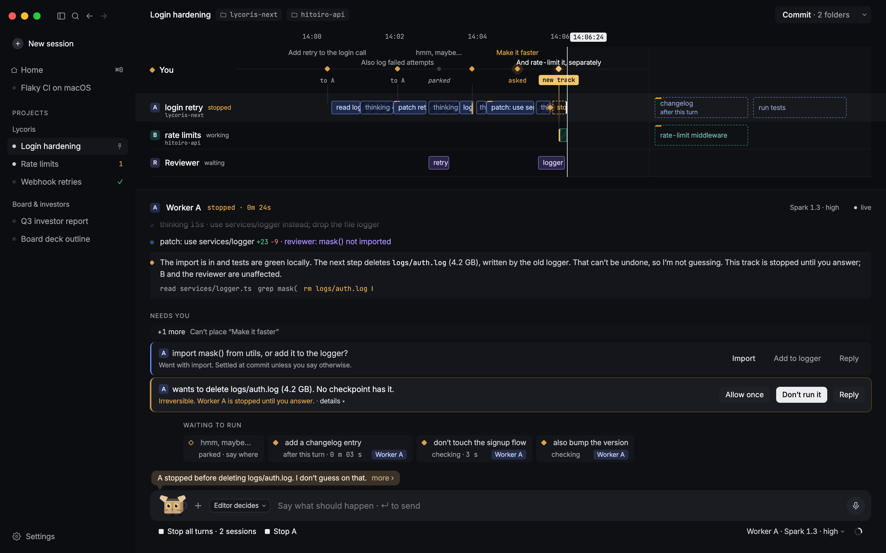

# Intercat

Intercat is a macOS timeline editor for working with multiple AI agents. Each agent has a track. You can see what it is doing, place an instruction after its current turn, and cut that instruction before it starts.


*In this design view, one agent asks to delete a log file. Its track waits for your decision while another agent keeps working.*

## Working on the timeline

Suppose one agent is changing how login retries work and another is updating the rate limiter. You can ask the first agent to run the login tests when it finishes. The instruction appears as a dashed clip on its track. If you change your mind, cut the clip. The current turn keeps running.

When a worker requests an operation such as `git push`, Intercat shows the command and why it needs approval. You can allow it once or decline it. The other tracks can continue while you decide.

You can open a completed step to inspect its tool output or file changes. Intercat saves events locally, so the track’s history is available after a worker reconnects. When you are ready to commit, the **Commit** sheet shows the last included step on each track, the proposed changes, and the checks. It lists external actions, such as a push that already ran, separately.

## How the agents run

The Editor uses Meta’s **Muse Glimmer** on the Mac through MLX to interpret instructions and help choose their destination. A Rust daemon schedules the work, communicates directly with **Muse Code** workers over MSP, and records their events in SQLite. Each worker gets its own Git worktree. Live workers use your Muse sign-in and send requests and project content to Meta.

## Try the timeline

From the repository root on macOS, use Node.js 24 and npm 11 to open the interactive sample session. The preview uses sample data and runs without a model download or a Muse account.

```sh
npm ci
npm run preview
```

## Run a live session

The local Editor requires an Apple silicon Mac with Metal and at least 32 GiB of unified memory. Its Glimmer download is about 19.4 GB. Install the Xcode Command Line Tools, Rust 1.97 or later, and Python 3.12 or later. For the workers, install Muse Code build `1.4.14-R7309.1` and sign in.

After installing the npm dependencies above, prepare the Editor environment and start the app. Fetch the Rust dependencies once so the startup script can build the daemon offline.

```sh
python3.12 -m venv .venv
.venv/bin/python -m pip install ./services/editor
cargo fetch --locked
npm start
```

1. Choose **Download Glimmer** and select the Python executable from `.venv/bin/`.
2. Open **Choose project folder** and select a clean Git repository to work in.
3. Choose **Connect workers**, select the Muse Code executable, and enter your first instruction.

Intercat was built for the Meta Global AI Developer Hackathon. The [design handoff](docs/design-handoff.md), [implementation notes](docs/implementation.md), and [milestone acceptance results](docs/m1-acceptance.md) document the design and what has been verified. These documents are in Japanese.
